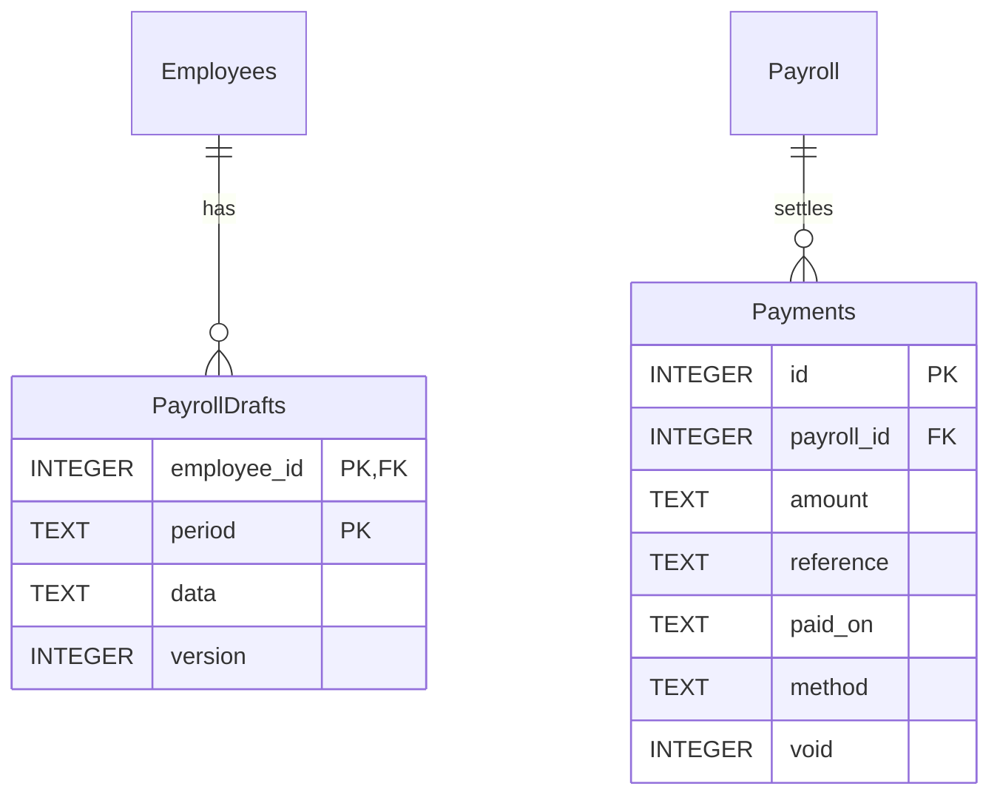
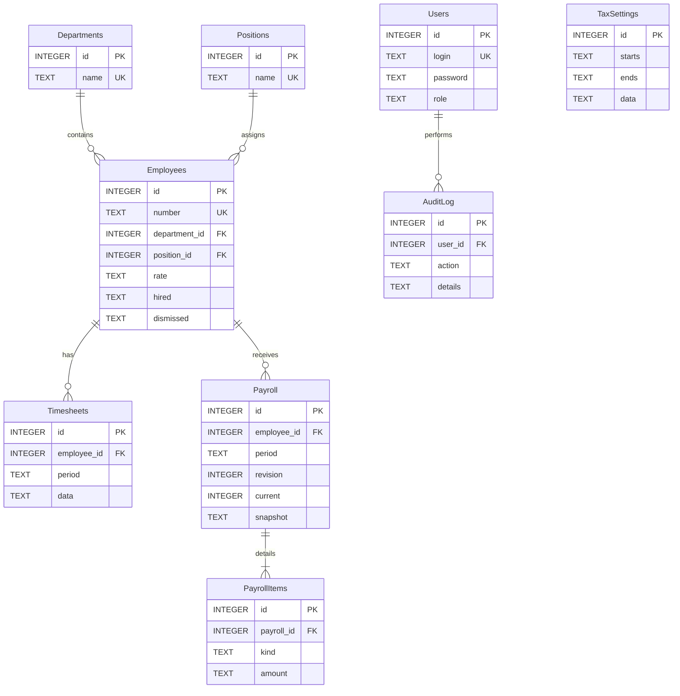
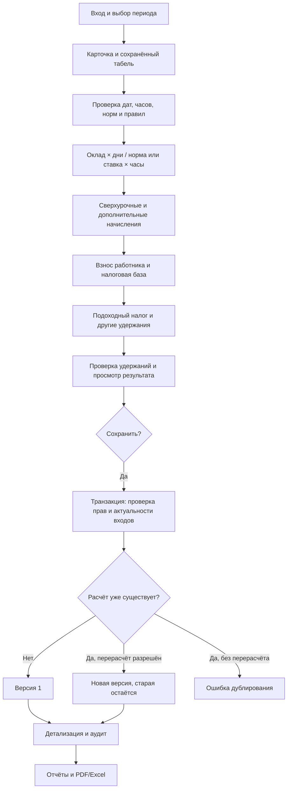

# Анализ, требования и архитектура

Обновление кадрового архива: в Employees добавляется dismissal_reason без удаления прежних полей. Таблица EmploymentEvents (employee_id и user_id — FK) хранит увольнения, изменения оснований и восстановления со снимком до/после. Изменение увольнения проверяет роль администратора в Store, независимо от состояния UI. `staff_stats.py` собирает статистику по текущим версиям Payroll, отдельно показывает прежние версии и отменённые выплаты, исключает будущие дни и даты вне трудоустройства. `ui_archive.py` отображает архив и профиль в обычной карточке.

`purge_employee` — отдельное действие администратора: версия карточки, точный номер, причина, BEGIN IMMEDIATE, резервная копия через отдельное читающее соединение, удаление дочерних Payments/PayrollItems, затем Payroll/PayrollDrafts/Timesheets/EmploymentEvents и Employees. Журнал удаления сохраняется. Ошибка в транзакции откатывает изменения; ошибка копирования запрещает удаление. Обычный delete_employee остаётся доступным только для пустых карточек. Существующие работники не меняют статус автоматически при миграции.

## Предметная область

Кадровые данные определяют тариф и период занятости. Табель фиксирует фактическое время. Бухгалтер проверяет календарную норму, начисления и удержания; налоговый справочник задаёт применимые параметры периода. Итоговая ведомость и расчётный листок должны воспроизводиться независимо от последующих изменений карточек. Основные риски: повторное начисление, потеря версии, неверная база налога, двоичное округление и раскрытие персональных данных.

## Требования

Функциональные: вход и роли; карточки и архив сотрудников; подразделения и должности; ежедневный месячный табель; окладная и почасовая оплата; премии, надбавки, дополнительные выплаты и удержания; датированные налоговые правила; предварительный просмотр; сохранение/перерасчёт; шесть видов отчётов; PDF/Excel; журнал и резервное копирование.

Нефункциональные: локальная работа Windows без обязательного интернета после установки; русский интерфейс; денежная арифметика Decimal; транзакционность; целостность SQLite; повторяемость по снимкам входов; разграничение ролей; отсутствие общих паролей. Архивирование предпочтительно физическому удалению. Специальные законодательные алгоритмы ограничены явно описанной в README моделью.

## Слои

`app.py` — формы Streamlit и состояние сеанса. `engine.py` — чистые функции проверки и вычисления, не зависит от UI/SQL. `store.py` — SQLite, транзакции, права, PBKDF2, аудит, сохранение версий. `reports.py` — Pandas, агрегирование Decimal, Excel и кириллический PDF. `demo.py` — воспроизводимые условные сотрудники. `schema.sql` — DDL с внешними ключами и уникальными индексами. `tests/test_payroll.py` — автоматические проверки.

Дополнение для кофейни: `ui_staff.py` — карточки и справочники, `ui_time.py` — сменный табель, `ui_pay.py` — черновики, расчёт и выплаты; `cafe.py` — идемпотентные примеры; `launcher.py`, «Запустить.vbs» и «Остановить.vbs» — управление фоновым сервером. `.streamlit/config.toml` задаёт оформление без CSS. `Payments` связывается с конкретной версией Payroll; действующая выплата блокирует перерасчёт. Отмена выплаты остаётся в БД и журнале. `PayrollDrafts` хранит доплаты/удержания по сотруднику и месяцу. Миграция дополняет Employees полями version и schedule, Timesheets — version, сохраняя прежние строки.



Выплаты записываются в BEGIN IMMEDIATE, сумма остатка проверяется через Decimal. UNIQUE(payroll_id, reference) предотвращает повтор документа; частичные выплаты не могут превышать net. Удаление сотрудников разрешено только при отсутствии зависимостей и только администратору. Редактирование сотрудников, табелей и черновиков поддерживает проверку версии; оплата и перерасчёт сериализуются транзакциями. Конфигурация ставок не реализует полный набор специальных налоговых режимов: границы применения остаются в README.

Структура:

```text
payroll/
  app.py
  engine.py
  store.py
  reports.py
  demo.py
  schema.sql
  requirements.txt
  start.bat
  README.md
  tests/test_payroll.py
  docs/architecture.md
  docs/test-results.txt
  data/payroll.sqlite3      (создаётся при запуске)
  .venv/                   (локальные зависимости)
```

## ER-диаграмма



Полное определение типов и ограничений — в schema.sql. Dates — ISO 8601, period — YYYY-MM, денежные поля — TEXT с Decimal в сервисе. Timesheets уникальны по сотруднику/месяцу; Payroll — по сотруднику/месяцу/версии; частичный уникальный индекс разрешает единственную текущую версию. JSON содержит детальную структуру ежедневных строк, правил и снимков. TaxSettings связывается с расчётом по дате, а копия использованных правил хранится в snapshot; изменение справочника не меняет историю.

## Алгоритм



При сохранении BEGIN IMMEDIATE блокирует конкурирующие записи. Внутри транзакции выполняется повторный расчёт по текущим входам и проверяется соответствие предпросмотру. Старую версию снимают с current и новую записывают в одной транзакции. Ошибка откатывает все изменения. Отчёты суммируют только current=1; история отображает все версии. Денежные величины округляются по компонентам HALF_UP до копеек/дирамов; правило округления требует проверки на соответствие применимому законодательству.
